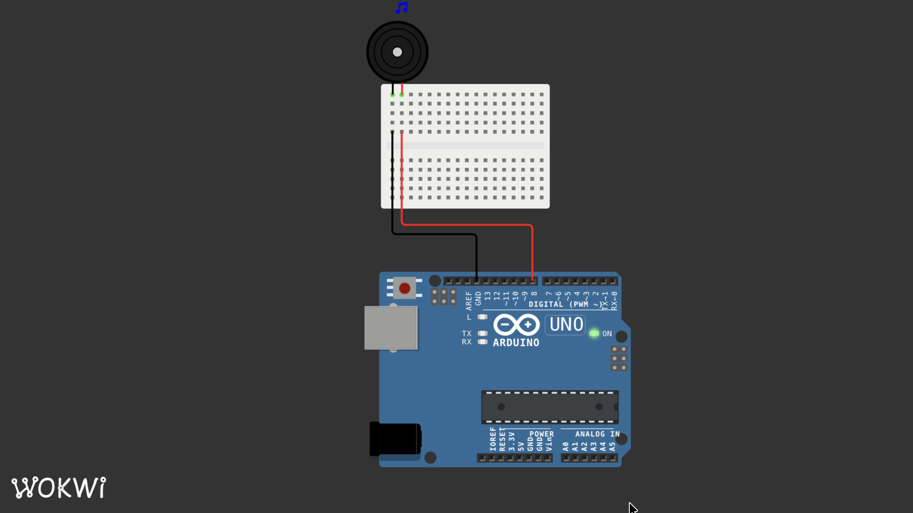

# Für Elise - Beethoven (🇺🇸🇧🇷🇪🇸🇯🇵🇨🇳)

## [EN] Für Elise on Arduino

Arduino code to play the melody of **Für Elise (Für Elise / Bagatelle No. 25 in A minor, WoO 59)** by Ludwig van Beethoven, using a piezo buzzer.

## The Music

The song "Für Elise" was chosen for this project because of a childhood memory of my brother having a watch from the Disney movie "Cars" that, when a button was pressed, would play this song, in the same arrangement that I wrote in the score below.

It's just not in the same key as the original; I'll still try to write it in the genuine tone.

### Components

- Arduino

- Piezo buzzer

- Two jumpers

### The Code

The main code it's here:

[`musica.ino`](./musica.ino)

## [PT-BR] Für Elise no Arduino

Código Arduino para reproduzir a melodia de **Für Elise (Für Elise / Bagatelle No. 25 in A minor, WoO 59)**, de Ludwig van Beethoven, utilizando um buzzer.

## A Música

A música "Für Elise" foi escolhida para este projeto por uma recordação de quando eu era criança, que meu irmão possuia um relógio do filme "Carros", da disney, que ao pressionar um botao emitia esta musica, neste mesmo arranjo que escrevi na partitura que está na parte superior do arquivo. Só não está na mesma tonalidade que a original, ainda vou tentar escrever no tom genuíno.

### Componentes

- Arduino

- Buzzer piezoelétrico

- Dois jumpers

### Código

O código principal está disponível em:

[`musica.ino`](./musica.ino)

## [ES] Para Elisa en Arduino

Código Arduino para reproducir la melodía de **Para Elisa (Bagatela n.º 25 en la menor, WoO 59)**, de Ludwig van Beethoven, usando un zumbador.

## La Música

Elegí la música "Para Elisa" para este proyecto por un recuerdo de mi infancia: mi hermano tenía un reloj de la película de Disney "Cars" que, al presionar un botón, reproducía esta música, con el mismo arreglo que escribí en la partitura al principio del archivo. Solo que no está en la misma tonalidad que la original; intentaré escribirla en la tonalidad original más adelante.

### Componentes

- Arduino

- Zumbador piezoeléctrico

- Dos puentes

### Código

El código principal está disponible en:

[`musica.ino`](./musica.ino)

## [JP] Arduinoでエリーゼのために

ルートヴィヒ・ヴァン・ベートーヴェンの「エリーゼのために」（バガテル第25番 イ短調、WoO 59）のメロディーをブザーで再現するArduinoコードです。

## 楽曲について

このプロジェクトに「エリーゼのために」を選んだのは、幼い頃の思い出があるからです。兄がディズニー映画「カーズ」の時計を持っていて、ボタンを押すとこの曲が流れるようになっていました。楽譜の冒頭に書いたのと同じアレンジです。原曲とは調が違いますが、後日原曲の調で書き直す予定です。

### 構成部品

- Arduino

- ピエゾブザー

- ジャンパー線2本

### コード

メインコードは以下の場所にあります。

[`musica.ino`](./musica.ino)

## [CH] 用 Arduino 重现贝多芬《致爱丽丝》

这段 Arduino 代码使用蜂鸣器重现了路德维希·范·贝多芬的《致爱丽丝》（Für Elise / Bagatelle No. 25 in A minor, WoO 59）的旋律。

## 音乐

之所以选择《致爱丽丝》作为本项目的配乐，是因为我童年的一段回忆：我哥哥有一个迪士尼电影《汽车总动员》里的钟，按下按钮就能播放这首曲子，乐谱的编排和我写在文件顶部的乐谱一模一样。只是调子和原曲不一样；我之后会尝试用原调重新写一遍。

### 组件

- Arduino

- 压电蜂鸣器

- 两根跳线

### 代码

主代码位于：

[`musica.ino`](./musica.ino)
